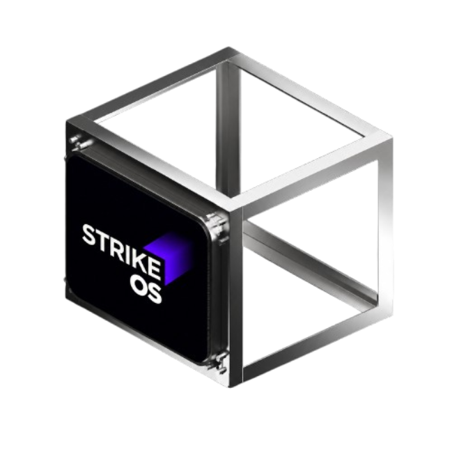
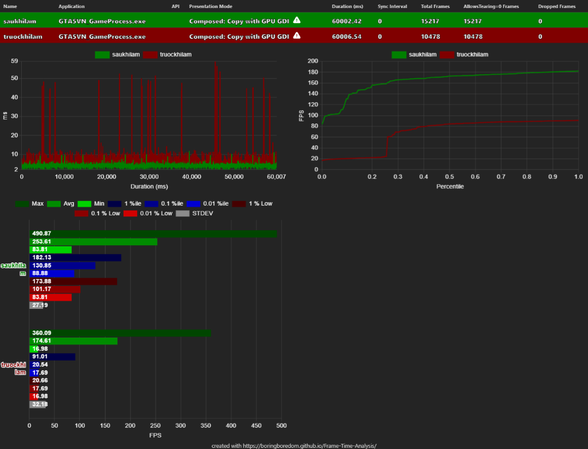
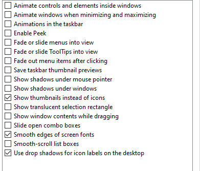
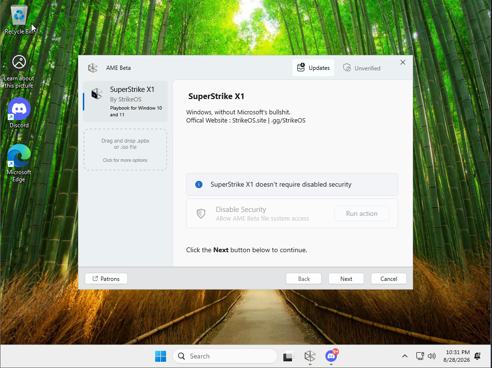
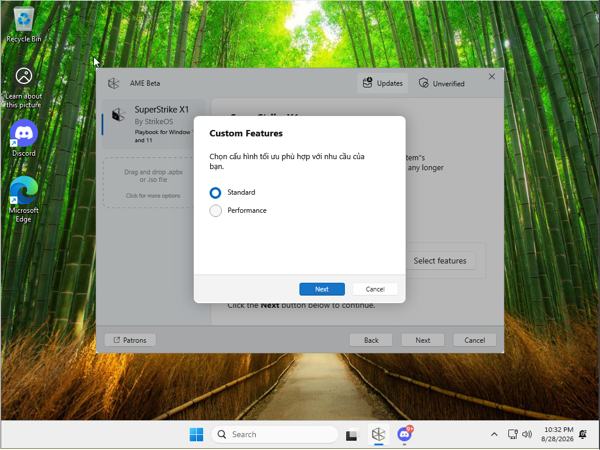

<div align="center">
  <picture>
    
  </picture>

  <p>
    <a href="https://github.com/StrikeOS/Superstrike-x1/releases">
      
    </a>
    
    
    
    <a href="https://discord.gg/StrikeOS">
      
    </a>
    <a href="https://strikeos.site">
      
    </a>
  </p>
</div>

---

<div align="center">

<table align="center" width="85%">
<tr>
<td width="65%" align="center">

<h2>Windows, without Microsoft's bullshit.</h2>

SuperStrike X1 is an open Windows optimization playbook executed through <strong>AME Wizard</strong>.

<br>

Designed specifically for <strong>frametime consistency and competitive latency</strong>:
empirically-backed kernel configuration, driver interrupt balancing, and modular revert scripts.

<br>

100% opt-in. Every tweak is optional: uncheck what you want to keep, and check only what you need.
Windows Defender, Riot Vanguard (CFG/DEP), and native Windows servicing are strictly preserved.
A single reboot is required after completion.

<br>

<strong>Low Latency · Frametime Consistency · Anti-Cheat Ready · Fully Reversible</strong>

</td>
<td width="35%" align="center">



</td>
</tr>
</table>

</div>

---

> [!NOTE]
> **Zero-Placebo Principle.** SuperStrike rejects outdated registry "hacks" (such as broken cache locks or forced MPO disabling). Every adjustment operates on verified Windows subsystem settings with measurable DPC/frametime impact.

---

## 1. Verified In-Game Telemetry & Benchmarks

Performance claims must be substantiated by empirical data. Below is a repeatable 60-second capture loop comparing stock Windows against SuperStrike X1 under identical hardware, driver, and thermal conditions running **GTA5VN / FiveM (`GTASVN_GameProcess.exe`)**:

<p align="center">
  
</p>

### Metric Comparison Table (PresentMon Capture)

| Telemetry Metric | Stock Windows (Before) | SuperStrike X1 (After) | Direct Variance |
| :--- | :---: | :---: | :---: |
| **Average Framerate** | 174.61 FPS | **253.61 FPS** | **+45.24%** |
| **1% Low FPS (Micro-stutter)** | 20.66 FPS | **173.88 FPS** | **+741.6%** (Eliminated severe hitching) |
| **0.1% Low FPS** | 17.69 FPS | **101.17 FPS** | **+471.9%** |
| **Minimum FPS** | 16.98 FPS | **83.81 FPS** | **+393.5%** |
| **Frametime Deviation (StDev)** | 32.18 ms | **27.19 ms** | **-4.99 ms** (Tight frametime pacing) |
| **Total Frames in 60s Loop** | 10,478 frames | **15,217 frames** | **+4,739 frames rendered** |
| **Dropped Frames** | 0 | **0** | Clean presentation |
| **Idle Process Count** | 160–180+ | **~70–85** | ~55% background reduction |

> [!WARNING]
> These figures reflect a CPU-bound multiplayer game environment. Results will scale depending on CPU cache architecture, memory latency, and GPU tier.

---

## 2. Core Engineering Architecture

SuperStrike X1 structures its optimizations across four isolated subsystems:

```
[Hardware Interrupts & NIC] ──► [Kernel Timing & TSC] ──► [SvcHost Consolidation] ──► [Display & DirectFlip]
```

### A. Memory & Kernel Management
- **Dynamic RAM Gating:** Automatically detects total physical memory. On systems with **$\ge$ 12GB RAM**, sets `DisablePagingExecutive = 1` and `DisablePageCombining = 1` to prevent sudden paging pauses. On systems with **< 12GB RAM**, preserves default paging to eliminate out-of-memory crashes.
- **Filesystem Efficiency (`fsutil`):** Forces NTFS TRIM notification (`DisableDeleteNotify = 0`), removes filesystem access timestamps (`disablelastaccess 1`), and turns off legacy 8.3 filename overhead (`disable8dot3 1`).

### B. Hardware & Network Stack (`StrikeHardware.ps1`)
- **NIC Physical Layer (PHY) Optimization:** Disables Energy Efficient Ethernet (`EEE`), Green Ethernet, and interface `SelectiveSuspend` to stop network chips from entering low-power throttling states between game packets.
- **Latency Queuing:** Disables Large Send Offload (`LSO v4/v6`) and Receive Segment Coalescing (`RSC`) to eliminate artificial packet delay buffers. Enables Receive Side Scaling (`RSS`) matched to physical cores.
- **Message Signaled Interrupts (MSI Mode):** Assigns dedicated vector MSI interrupts with High Priority (`DevicePriority = 2`) to the GPU and Network Controller, resolving IRQ sharing conflicts.

### C. Display & Presentation Pipeline
- **WDDM 3.0+ DirectFlip Compliance:** Retains Hardware-Accelerated GPU Scheduling (`HAGS`) and native DirectFlip presentation mode for modern windowed gaming. Does not force `DisableMPO` or override valid display presentation pipelines.
- **Driver Background Latency:** Disables diagnostic trace overhead in display drivers (`EventTracer = 0`, `ResetPerfMonD4 = 0`), disables Ansel background hooks, and halts AMD ULPS (`KMD_EnableUlps = 0`) to prevent core clock drops.

### D. Process Consolidation & Thread Discipline
- **SvcHost Memory Consolidation:** Applies `SvcHostSplitThresholdInKB = 0xFFFFFFFF` across 160+ system services, grouping fragmented background threads into unified hosting instances to reduce context-switching cost.
- **Service Streamlining (`StrikeServices.json`):** Halts and sets 68 non-essential background daemons (`DiagTrack`, `dmwappushservice`, `RetailDemo`, `PcaSvc`, etc.) to Disabled.
- **Defender Throttling:** Rather than corrupting security binaries, Defender's CPU throttle is configured to a manageable cap (`AvgCPULoadFactor = 15`) with standard gaming extensions excluded from real-time scans (`.rpf`, `.pak`, `.vpk`, `.assets`, `.bundle`, `.bank`).

---

## 3. Desktop & Visual Effects Preset

SuperStrike strikes a balance between clean system response and functional desktop usability. All window sliding and fading animations are trimmed while preserving critical font rendering and explorer usability:

<p align="center">
  
</p>

- **Smooth edges of screen fonts** — Enabled (maintains ClearType font readability across high-DPI displays).
- **Show thumbnails instead of icons** — Enabled (essential for media workflows and image browsing).
- **Use drop shadows for icon labels on the desktop** — Enabled (readable text over custom wallpapers).
- **All window fades, menu animations, and sliding combo boxes** — Disabled (instant desktop response).

---

## 4. Playbook Configuration Pages

Every setting in SuperStrike X1 is controlled via the AME Wizard setup screen. By default, **all checkboxes are unchecked**, ensuring that no component is removed without explicit user consent:

<div align="center">

| Page | Title / Section | Available Options | Default State |
| :---: | :--- | :--- | :---: |
| **1** | Optimization Profile | `Performance` / `Standard` | Performance |
| **2** | System App Removals | `Microsoft Edge`, `Microsoft OneDrive`, `Xbox App & Game Bar` | Unchecked (Opt-in) |
| **3** | Modern AI & Feeds | `Widgets & News Feed`, `Copilot, Recall & Windows AI` | Unchecked (Opt-in) |
| **4** | Desktop & UI | `Disable Transparency`, `Classic Context Menu (Win 10)` | Unchecked (Opt-in) |
| **5** | Peripherals & Services | `Search Indexing`, `Bluetooth`, `Print Spooler`, `Touch Keyboard` | Unchecked (Opt-in) |
| **6** | Web Browser | `None`, `Brave`, `Mozilla Firefox`, `Google Chrome` | Brave (Selectable) |

</div>

---

## 5. Chassis Adaptation Matrix (Desktop vs Laptop)

SuperStrike detects whether the target machine is a stationary desktop or a portable notebook, dynamically tailoring power and peripheral policies:

<div align="center">

| Subsystem Setting | Desktop Implementation | Laptop / Mobile Implementation |
| :--- | :---: | :---: |
| **AC Power Plan** | High Performance (100% Unparked Cores) | Dynamic Gaming Profile |
| **DC (Battery) Profile** | N/A | Balanced (Standard battery protection) |
| **D3Cold & USB Selective Suspend** | Disabled (Max peripheral responsiveness) | Preserved (Prevents idle battery drain) |
| **PCIe Power Management** | Off (Active clock state) | Moderate power management |
| **Display & GPU Acceleration** | HAGS + High-performance graphics profile | HAGS + Hybrid GPU switching safe |

</div>

---

## 6. PostInstall Maintenance & Revert Suite

Every change made during the playbook installation is accompanied by a standalone revert script located in `C:\Users\Public\Desktop\PostInstall\` (and inside the playbook repository). All tools feature clear English menus:

```
PostInstall\
├── 1. Trinh Duyet\                  -> Clean browser installers (Brave, Chrome, Firefox)
├── 2. Toi Uu Gaming\
│   ├── Toggle-Power-Plan.bat         -> Switch between Ultimate, High, and Balanced plans
│   ├── DirectFlip-CPU-Hybrid.bat     -> Inspect/toggle DirectFlip & CPU scheduling hooks
│   └── 2. GPU\
│       └── Toggle-MPO-HAGS.bat       -> Inspect and toggle MPO / HAGS registry states
└── 5. Khac Phuc Su Co\
    ├── 1. Toggle-VBS-Core-Isolation.bat -> Enable/Disable Virtualization-Based Security
    ├── 2. Toggle-Windows-Update.bat     -> Enable/Disable Windows Update & Delivery Optimization
    ├── 3. Toggle-Windows-Defender.bat   -> Enable/Disable Real-time Protection & Cloud Sampling
    ├── 4. Restore-Visual-Effects.bat    -> Restore Windows default animations and thumbnails
    ├── 5. Toggle-WiFi-Bluetooth.bat     -> Restore wireless service dependencies
    └── 6. Toggle-Print-Spooler.bat      -> Restore printer service dependencies
```

---

## 7. Installation Walkthrough

<p align="center">
  
  &nbsp;&nbsp;
  
</p>

1. **Obtain Files:** Download `Superstrike-x1.apbx` from [GitHub Releases](https://github.com/StrikeOS/Superstrike-x1/releases) and grab the [AME Wizard Beta](https://download.ameliorated.io/AME%20Beta.zip).
2. **Execute Wizard:** Open `AME Wizard.exe` as Administrator.
3. **Load Playbook:** Drag and drop `Superstrike-x1.apbx` into the wizard window (password: `malte` if prompted).
4. **Configure Options:** Review each page and toggle components according to your workflow.
5. **Finalize:** Allow the automated script execution to finish, then restart your PC.

---

## 8. Anti-Cheat & Operating System Compatibility

### Anti-Cheat Certification
SuperStrike X1 does not tamper with cryptographic subsystem signatures, kernel DEP, or Control Flow Guard (CFG). Tested and confirmed operational with:
- **Riot Vanguard** (VALORANT, League of Legends)
- **Easy Anti-Cheat** (Fortnite, Apex Legends, Rust)
- **BattlEye** (Rainbow Six Siege, PUBG, Destiny 2)
- **FACEIT Anti-Cheat** (CS2)
- **Ricochet** (Call of Duty: Warzone)

### Supported Windows Builds (AMD64 / x64 only)

<p align="center">
  
  
  
  
</p>

---

## 9. Frequently Asked Questions

<details>
<summary><strong>Why is VBS (Virtualization-Based Security) disabled by default?</strong></summary>

On modern Windows 11 builds, Memory Integrity (HVCI) and VBS introduce CPU virtualization overhead that can reduce 1% Low framerates by 5% to 15% in CPU-bound competitive games. It is disabled by default for optimal performance, but can be restored at any time via `1. Toggle-VBS-Core-Isolation.bat`.
</details>

<details>
<summary><strong>Does SuperStrike break Windows Update?</strong></summary>

No. The Windows Update servicing stack remains structurally intact. If you wish to defer or disable automatic background driver updates, use `2. Toggle-Windows-Update.bat` in the PostInstall folder.
</details>

<details>
<summary><strong>What should I select if I use a Gaming Laptop?</strong></summary>

Keep `Bluetooth`, `Print Spooler`, and `Touch Keyboard` unchecked if you use wireless peripherals or external printers. SuperStrike will automatically recognize laptop chassis architecture and safeguard battery management parameters.
</details>

<details>
<summary><strong>Can I install my own browser?</strong></summary>

Yes. On Page 6 of the playbook, select `None` to bypass automated browser downloads, or choose from Brave, Firefox, or Chrome to have it cleanly fetched from official vendor endpoints.
</details>

---

## Links & Verification

<p align="center">
  <a href="https://strikeos.site">
    
  </a>
  <a href="https://discord.gg/StrikeOS">
    
  </a>
  <a href="https://github.com/StrikeOS">
    
  </a>
</p>

```
SHA256 Verification:
Superstrike-x1.apbx : 00B7EC7999CC0792D25EC5628F44AE3823ADE0B66546A1EA156EF5B74E884EA4
Superstrike-x.apbx  : 74659A836C9BEBD337EF4B77C1C3E898B62BC1FE10D7CBD2DAD00590D30B8444
```

<p align="center">
  <sub>© 2026 StrikeOS · SuperStrike X1 · Zero-Placebo Optimization Architecture</sub>
</p>
